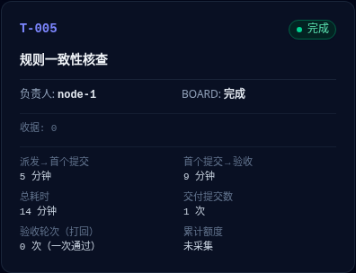

# T-047：Tower 卡片实测遥测

## 借的是什么模式、为什么不换库

借的是任务书指定的 OverClick「卡上实测遥测」呈现，以及 Retinue「节点额度卡」明确展示消耗和未知状态的思路；本次只把现成数据派生的时长、交付提交数、打回次数和额度状态放到现有任务卡。Tower 的事实源继续是 GitHub 仓库与现有收据。替换成另一套系统会迁移派活、认领、交付、验收、回执及治理协议，收益不足以覆盖迁移成本。因此不换仓库总线、不换库、不新增埋点、服务或页面，不改 RULES；部署沿用 T-039 自愈脚本和现有两项 systemd 服务。

## 交付位置与状态

- 日期：2026-11-16 UTC。Codex 实现与自测已完成；Antigravity 独立复核、总控终验由原任务流程处理，本报告不代签。
- Tower 私有仓库：`xy3293/muse-control-tower`；`gh repo view --json isPrivate` 实测 `true`。
- 开工 `git ls-remote origin refs/heads/integration`：`84672148f92f468fd1578b8fc8b5680535c234d9`。
- 代码提交并已普通 fast-forward push：[`d70c4056718d17f0bac9823818ad3919f9a28fd3`](https://github.com/xy3293/muse-control-tower/commit/d70c4056718d17f0bac9823818ad3919f9a28fd3)，分支 `integration`；远端读回同 SHA，工作树干净。未 force push、删库或改 RULES。
- 本目录附 [独立复算脚本](verify.py)、[逐条命令输出](verification.txt)、[完整遥测对照 JSON](comparison.json)、[浏览器检查](browser-check.json) 与 [现有任务卡截图](task-card.png)。

## 计算口径与来源

1. 派发时间：与 GitHub BOARD 同一 HEAD 下，`git log --first-parent --reverse -- BOARD.md` 中该任务首次进入待领/进行中/待验收的提交 **committer time `%cI`**。如果首次出现已经完成，不能倒推派发时间，相关字段为 null。
2. 首个交付：完整 DAG 中任务号为主题前缀的非 merge 提交，兼容现有 `【N号】T-xxx`、`[node-N] T-xxx`、`T-xxx` 和历史 `P0/T-018` 签名。muse-hub 必须实际修改 `results/node-N/`，并匹配任务负责人；总控派发/认领/验收/ACK/笔误修正不计。Tower integration 的任务前缀代码提交由同一现有私库历史提供。交付按 SHA 去重，不把 merge 再数一次。
3. 验收完成：BOARD 当前完成状态对应的最后一次进入“完成”的提交时间。无关文案更新不移动终点；重开任务后，直到再次完成才重新产生验收终点。PASS 收据的 `reviewed_at` 只作为复核证据，不能替换 BOARD 完成时间。
4. 三个耗时分别为首个交付减派发、验收减**首个交付**、验收减派发。API 保留整数秒；卡片以 `Math.round(seconds / 60)` 显示分钟。未完成不拿当前时间填充最终耗时；缺数据或时间次序冲突显示“未采集”。
5. 交付提交数为快照内所有已记录的本任务交付版本数，包含验收后修订；验收终点仍遵守 BOARD。完整历史能证明没有交付时为 0；历史不可读时为 null，不伪造 0。T-030 存在先关闭后交结果的历史，提交到验收耗时据实为 null 并解释时间冲突。
6. 验收轮次按任务书定义显示**打回次数**，不是总审查次数：现有 REJECT 收据按任务/负责人/被拒 SHA 去重；BOARD 的拒收变更映射到当时最近的交付版本，同版本只计一次。收据目录不可读/损坏或派发不明时不武断填 0；已完成任务记录为 0 时显示“一次通过”。现有 T-021 为 3 次、T-024 为 1 次，未把 T-021 的其他节点错投收据计入 node-1。
7. 使用现有 `~/workspace/muse-hub-git` 完整 Git 历史、Tower integration 交付历史、`~/hooks/state/muse-hub/receipts/*.json`。GitHub BOARD HEAD 必须已在本地对象库中；本功能没有 fetch、来源写入、心跳或新进程。历史按 HEAD 缓存在现有后端进程内，收据按文件元数据变更重读。

现有 runtime-config 仅列了 5 份收据，本机实际有 46 份。本次为遥测只读完整现有收据目录，避免漏掉历史 REJECT；原有状态、验收证据和卡片收据数继续按原接口契约工作，没有用遥测篡改任务状态。

## 字段与旧客户端兼容性

保留原冻结文件 `contracts/muse-control-tower-stage1-openapi-1.1.0.yaml` 不变；新建版本化 `...-1.1.1.yaml`，同样 13 路径、17 操作。新增可选 `Task.telemetry` 对象（列表、单任务和已有概览中的 Task 均可返回），Python DTO 与 TypeScript 类型同步更新。字段遵循现有 snake_case 风格：

| 新字段 | 意义 / 未采集表示 |
|---|---|
| `dispatched_at`、`first_delivery_at`、`accepted_at` | 原始证据时间，未知 null |
| `dispatch_to_first_commit_seconds` | 派发到首个交付的秒数，未知 null |
| `commit_to_acceptance_seconds` | 首个交付到 BOARD 完成的秒数，未知 null |
| `total_seconds` | 派发到 BOARD 完成的秒数，未知 null |
| `delivery_commit_count` | 交付提交数，未知 null |
| `rejection_count` | 被打回次数，未知 null；0 表示未记录打回 |
| `quota_used` | 任务累计消耗；本次来源无可用数值，null |
| `quota_status`、`quota_reason` | “未采集”及缺失原因 |
| `evidence_refs`、`missing_reasons` | Git/收据来源标识、未采集原因，不返回本地绝对路径 |

旧客户端若忽略新增响应属性，可继续读取全部原字段；新前端连接旧后端时，缺少 telemetry 的六项字段显示“未采集”。**旧 1.1.0 的严格响应验证器因 Task 的 `additionalProperties: false` 会拒绝新增属性，需升级到 1.1.1**，因此没有声称所有旧客户端无条件兼容。没有新增 API 或页面。现有表格任务行、任务卡、原任务详情卡共用同一展示组件。

## 额度为什么统一“未采集”

检查了全部 46 份现有收据（含 `checks`/`summary`）、现有 46 份任务书，并逐个核对抽样任务对应收据及以下任务书：

- `tasks/T-023-ab-tick.md`
- `tasks/T-005-rule-consistency-audit.md`
- `tasks/T-028-step6b-evidence-review-node1.md`

现有收据顶层字段并集为 `checks,event_id,node_id,reviewed_at,schema_version,source_paths,status,summary,task_id,verdict,version_sha`；无任务累计 token、金额、额度消耗字段。文本中的额度充足、剩余额度或订阅百分比也不是这项任务的累计消耗记录。三份抽样收据都只有验收检查及时间，没有可归属该任务的消耗数字；故 `quota_used=null`、`quota_status=未采集`，不把余额换算成消耗，也不以运行时间估计 token。

## 随机抽样与手算 / Tower 并列

开工时 muse-hub BOARD 快照 `1c819c6ea5c708687472c02f61c29a76c2f3dddd`，44 个已完成任务全部纳入，按编号排序后 `random.Random(47).sample(..., 3)`：**T-023、T-005、T-028**。未筛选、未重抽。抽样命令和每个时间锚点、BOARD 行变更、交付历史、收据元数据见下方原始输出；复算脚本不导入 Tower 代码。

```bash
cd ~/workspace/muse-hub-git
python3 evidence/T-047-tower-telemetry/verify.py
```

| 任务 | 项目 | 手工计算 | Tower API | 差值 |
|---|---|---|---|---|
| T-023 | 派发→首交 | 08:09:23Z − 08:04:23Z = 300s（5分） | 300s | 0s |
| T-023 | 首交→验收 | 08:17:17Z − 08:09:23Z = 474s（8分） | 474s | 0s |
| T-023 | 总耗时 | 08:17:17Z − 08:04:23Z = 774s（13分） | 774s | 0s |
| T-005 | 派发→首交 | 13:28:22Z − 13:23:05Z = 317s（5分） | 317s | 0s |
| T-005 | 首交→验收 | 13:37:25Z − 13:28:22Z = 543s（9分） | 543s | 0s |
| T-005 | 总耗时 | 13:37:25Z − 13:23:05Z = 860s（14分） | 860s | 0s |
| T-028 | 派发→首交 | 09:23:37Z − 09:18:32Z = 305s（5分） | 305s | 0s |
| T-028 | 首交→验收 | 10:13:30Z − 09:23:37Z = 2993s（50分） | 2993s | 0s |
| T-028 | 总耗时 | 10:13:30Z − 09:18:32Z = 3298s（55分） | 3298s | 0s |

T-023/T-028 日期均为 2026-11-15，T-005 为 2026-11-11；+08:00 时间已减 8 小时转 UTC。卡片分钟舍入与原始秒数相差不超过 30 秒，满足 ±1 分钟。

| 任务 | 手工交付数 / API | 手工打回 / API | 额度 / API |
|---|---|---|---|
| T-023 | a77a7f1，一份 / 1 | BOARD 无拒收，收据只有 PASS / 0 | 无任务消耗记录 / 未采集 |
| T-005 | cd7823e，一份 / 1；496b973 是总控验收时修笔误，排除 | BOARD 无拒收，收据只有 PASS / 0 | 无任务消耗记录 / 未采集 |
| T-028 | fe441a5，一份 / 1 | BOARD 无拒收，收据只有 PASS / 0 | 无任务消耗记录 / 未采集 |

### 命令与实际输出

以下由上述脚本独立读取 Git 和真实 `GET /api/v1/tasks/{task_id}`，认证密钥只在进程内存中，不输出或写入证据。

```text
{"board_head": "1c819c6ea5c708687472c02f61c29a76c2f3dddd", "completed": 44, "seed": 47, "sample": ["T-023", "T-005", "T-028"]}
$ git show -s --format='%H %cI %s' 78ce4ee360dec5f56a92b5cf04ef87f0aaa4f7f8
78ce4ee360dec5f56a92b5cf04ef87f0aaa4f7f8 2026-11-15T16:04:23+08:00 T-023：派 node-2 A/B 无人值守实测 tick
$ git show -s --format='%H %cI %s' a77a7f156b526ccc63add297d6d71fcce80bc975
a77a7f156b526ccc63add297d6d71fcce80bc975 2026-11-15T08:09:23+00:00 【2号】T-023 ab tick
$ git show -s --format='%H %cI %s' 6dd2ec60ae609bacbaecb422b3550e774d7a9bbc
6dd2ec60ae609bacbaecb422b3550e774d7a9bbc 2026-11-15T08:17:17+00:00 T-023 验收通过：BOARD 状态改完成
$ git show --format= --unified=0 78ce4ee360dec5f56a92b5cf04ef87f0aaa4f7f8 -- BOARD.md  # task row only
+| T-023 | A/B 无人值守实测 tick：node-2 最小常规任务 | node-2 | 待领 | tasks/T-023-ab-tick.md | [#25](https://github.com/xy3293/muse-hub/issues/25) |
$ git show --format= --unified=0 6dd2ec60ae609bacbaecb422b3550e774d7a9bbc -- BOARD.md  # task row only
-| T-023 | A/B 无人值守实测 tick：node-2 最小常规任务 | node-2 | 待领 | tasks/T-023-ab-tick.md | [#25](https://github.com/xy3293/muse-hub/issues/25) |
+| T-023 | A/B 无人值守实测 tick：node-2 最小常规任务 | node-2 | 完成 | tasks/T-023-ab-tick.md | [#25](https://github.com/xy3293/muse-hub/issues/25) |
$ git log --no-merges --format='%H %cI %s' 1c819c6ea5c708687472c02f61c29a76c2f3dddd -- results/node-2/T-023*
a77a7f156b526ccc63add297d6d71fcce80bc975 2026-11-15T08:09:23+00:00 【2号】T-023 ab tick
receipt metadata: [{"task_id": "T-023", "node_id": "node-2", "version_sha": "a77a7f156b526ccc63add297d6d71fcce80bc975", "verdict": "PASS", "reviewed_at": "2026-11-15T08:14:00Z"}]
hand arithmetic / API / differences: {"task": "T-023", "hand": {"dispatch_to_first_commit_seconds": 300, "commit_to_acceptance_seconds": 474, "total_seconds": 774, "delivery_commit_count": 1, "rejection_count": 0}, "api": {"dispatch_to_first_commit_seconds": 300, "commit_to_acceptance_seconds": 474, "total_seconds": 774, "delivery_commit_count": 1, "rejection_count": 0}, "differences": {"dispatch_to_first_commit_seconds": 0, "commit_to_acceptance_seconds": 0, "total_seconds": 0, "delivery_commit_count": 0, "rejection_count": 0}}
Tower telemetry: {"dispatched_at": "2026-11-15T16:04:23+08:00", "first_delivery_at": "2026-11-15T08:09:23Z", "accepted_at": "2026-11-15T08:17:17Z", "dispatch_to_first_commit_seconds": 300, "commit_to_acceptance_seconds": 474, "total_seconds": 774, "delivery_commit_count": 1, "rejection_count": 0, "quota_used": null, "quota_status": "未采集", "quota_reason": "现有收据和任务书未提供可核验的任务累计消耗记录；余额或订阅百分比不等于任务消耗。", "evidence_refs": ["github:6dd2ec60ae609bacbaecb422b3550e774d7a9bbc", "github:78ce4ee360dec5f56a92b5cf04ef87f0aaa4f7f8", "github:a77a7f156b526ccc63add297d6d71fcce80bc975"], "missing_reasons": []}
$ git show -s --format='%H %cI %s' 42f5ae5e00c34947b0120673464407aeaf0d1805
42f5ae5e00c34947b0120673464407aeaf0d1805 2026-11-11T21:23:05+08:00 【总控】派 T-005：规则一致性核查
$ git show -s --format='%H %cI %s' cd7823e089518bde0d0dc6aeda8fd7b52513d98f
cd7823e089518bde0d0dc6aeda8fd7b52513d98f 2026-11-11T13:28:22+00:00 【1号】T-005 规则一致性核查报告：17项不一致，6高8中3低
$ git show -s --format='%H %cI %s' 496b973c127522b7e226d7543154d2ff6fb86861
496b973c127522b7e226d7543154d2ff6fb86861 2026-11-11T21:37:25+08:00 【总控】T-005 验收通过：BOARD 完成 + 结论行计数笔误由总控修正
$ git show --format= --unified=0 42f5ae5e00c34947b0120673464407aeaf0d1805 -- BOARD.md  # task row only
+| T-005 | 规则一致性核查 | node-1 | 待领 | tasks/T-005-rule-consistency-audit.md | [#5](https://github.com/xy3293/muse-hub/issues/5) |
$ git show --format= --unified=0 496b973c127522b7e226d7543154d2ff6fb86861 -- BOARD.md  # task row only
-| T-005 | 规则一致性核查 | node-1 | 待领 | tasks/T-005-rule-consistency-audit.md | [#5](https://github.com/xy3293/muse-hub/issues/5) |
+| T-005 | 规则一致性核查 | node-1 | 完成 | tasks/T-005-rule-consistency-audit.md | [#5](https://github.com/xy3293/muse-hub/issues/5) |
$ git log --no-merges --format='%H %cI %s' 1c819c6ea5c708687472c02f61c29a76c2f3dddd -- results/node-1/T-005*
496b973c127522b7e226d7543154d2ff6fb86861 2026-11-11T21:37:25+08:00 【总控】T-005 验收通过：BOARD 完成 + 结论行计数笔误由总控修正
cd7823e089518bde0d0dc6aeda8fd7b52513d98f 2026-11-11T13:28:22+00:00 【1号】T-005 规则一致性核查报告：17项不一致，6高8中3低
receipt metadata: [{"task_id": "T-005", "node_id": "node-1", "version_sha": "cd7823e089518bde0d0dc6aeda8fd7b52513d98f", "verdict": "PASS", "reviewed_at": "2026-11-11T13:32:17Z"}]
hand arithmetic / API / differences: {"task": "T-005", "hand": {"dispatch_to_first_commit_seconds": 317, "commit_to_acceptance_seconds": 543, "total_seconds": 860, "delivery_commit_count": 1, "rejection_count": 0}, "api": {"dispatch_to_first_commit_seconds": 317, "commit_to_acceptance_seconds": 543, "total_seconds": 860, "delivery_commit_count": 1, "rejection_count": 0}, "differences": {"dispatch_to_first_commit_seconds": 0, "commit_to_acceptance_seconds": 0, "total_seconds": 0, "delivery_commit_count": 0, "rejection_count": 0}}
Tower telemetry: {"dispatched_at": "2026-11-11T21:23:05+08:00", "first_delivery_at": "2026-11-11T13:28:22Z", "accepted_at": "2026-11-11T21:37:25+08:00", "dispatch_to_first_commit_seconds": 317, "commit_to_acceptance_seconds": 543, "total_seconds": 860, "delivery_commit_count": 1, "rejection_count": 0, "quota_used": null, "quota_status": "未采集", "quota_reason": "现有收据和任务书未提供可核验的任务累计消耗记录；余额或订阅百分比不等于任务消耗。", "evidence_refs": ["github:42f5ae5e00c34947b0120673464407aeaf0d1805", "github:496b973c127522b7e226d7543154d2ff6fb86861", "github:cd7823e089518bde0d0dc6aeda8fd7b52513d98f"], "missing_reasons": []}
$ git show -s --format='%H %cI %s' 785eac55a03814287318c2e42e73f94182537cb8
785eac55a03814287318c2e42e73f94182537cb8 2026-11-15T17:18:32+08:00 T-028：派 node-1 Step 6b 证据脱敏副本独立复核（A/B A2）
$ git show -s --format='%H %cI %s' fe441a51946f96dfae3d66f7def59a2a0ba2418a
fe441a51946f96dfae3d66f7def59a2a0ba2418a 2026-11-15T09:23:37+00:00 T-028：Step 6b 证据脱敏副本独立复核（node-1）
$ git show -s --format='%H %cI %s' 2589df58e97e2371afba373600c6174ab5a2683b
2589df58e97e2371afba373600c6174ab5a2683b 2026-11-15T18:13:30+08:00 T-028 验收通过：BOARD 状态改完成
$ git show --format= --unified=0 785eac55a03814287318c2e42e73f94182537cb8 -- BOARD.md  # task row only
+| T-028 | Step 6b 证据脱敏副本独立复核 | node-1 | 待领 | tasks/T-028-step6b-evidence-review-node1.md | [#26](https://github.com/xy3293/muse-hub/issues/26) |
$ git show --format= --unified=0 2589df58e97e2371afba373600c6174ab5a2683b -- BOARD.md  # task row only
-| T-028 | Step 6b 证据脱敏副本独立复核 | node-1 | 待领 | tasks/T-028-step6b-evidence-review-node1.md | [#26](https://github.com/xy3293/muse-hub/issues/26) |
+| T-028 | Step 6b 证据脱敏副本独立复核 | node-1 | 完成 | tasks/T-028-step6b-evidence-review-node1.md | [#26](https://github.com/xy3293/muse-hub/issues/26) |
$ git log --no-merges --format='%H %cI %s' 1c819c6ea5c708687472c02f61c29a76c2f3dddd -- results/node-1/T-028*
fe441a51946f96dfae3d66f7def59a2a0ba2418a 2026-11-15T09:23:37+00:00 T-028：Step 6b 证据脱敏副本独立复核（node-1）
receipt metadata: [{"task_id": "T-028", "node_id": "node-1", "version_sha": "fe441a51946f96dfae3d66f7def59a2a0ba2418a", "verdict": "PASS", "reviewed_at": "2026-11-15T10:13:27Z"}]
hand arithmetic / API / differences: {"task": "T-028", "hand": {"dispatch_to_first_commit_seconds": 305, "commit_to_acceptance_seconds": 2993, "total_seconds": 3298, "delivery_commit_count": 1, "rejection_count": 0}, "api": {"dispatch_to_first_commit_seconds": 305, "commit_to_acceptance_seconds": 2993, "total_seconds": 3298, "delivery_commit_count": 1, "rejection_count": 0}, "differences": {"dispatch_to_first_commit_seconds": 0, "commit_to_acceptance_seconds": 0, "total_seconds": 0, "delivery_commit_count": 0, "rejection_count": 0}}
Tower telemetry: {"dispatched_at": "2026-11-15T17:18:32+08:00", "first_delivery_at": "2026-11-15T09:23:37Z", "accepted_at": "2026-11-15T18:13:30+08:00", "dispatch_to_first_commit_seconds": 305, "commit_to_acceptance_seconds": 2993, "total_seconds": 3298, "delivery_commit_count": 1, "rejection_count": 0, "quota_used": null, "quota_status": "未采集", "quota_reason": "现有收据和任务书未提供可核验的任务累计消耗记录；余额或订阅百分比不等于任务消耗。", "evidence_refs": ["github:2589df58e97e2371afba373600c6174ab5a2683b", "github:785eac55a03814287318c2e42e73f94182537cb8", "github:fe441a51946f96dfae3d66f7def59a2a0ba2418a"], "missing_reasons": []}
PASS: 3/3, exact seconds and counts; each minute rounding error <= 30 seconds
```

## 验证与 T-039 部署记录

- 后端 `python -m pytest -q`：**280 passed**（33.15s）；包括真实 Git fixture 覆盖合并去重、两种节点签名、历史别名、总控修正排除、时区、重复 REJECT 去重、重新打开、缺失历史/收据、跨仓库交付、单任务/列表一致。
- 前端 `bun test`：**27 pass, 0 fail**；`npm run build` 通过。现有工具链仍有 Tailwind sourcemap 提示和 TestClient 弃用提示，不影响本次检查。
- `git diff --check`、`bash -n deploy/repair-after-vm-replacement.sh`、systemd unit 校验通过；systemd 另报告了既存 syslog/apt/motd 配置提示。
- API 首次真实列表读取 `HTTP 200, total=47`；全部任务返回 telemetry，3 个样本由独立单任务请求复核，全部字段逐秒及计数相等。没有用 mock 充当真实验收证据。
- 浏览器实测 T-005 的现有表格/网格卡/原详情抽屉显示相同六项字段；`browser_errors=0`，见 [browser-check.json](browser-check.json)。
- 通过 T-039 发布：先保存原持久脚本 `.last-good`，更新原 `muse-tower-backend.service` 的只读源配置、同步原持久脚本，停止现有后端，再执行 `sudo -n /bin/bash ~/hooks/scripts/repair-after-vm-replacement.sh`；脚本输出 `unhealthy; restoring deployment` → `deployment recovered`。原后端/前端均 active；再次调用原脚本静默退出。Git 对象/refs 与现有收据的只读 ACL/默认 ACL 已归入原修复脚本，不加服务、unit 或 cron。
- 代码暂存区对两份实际凭据做内存固定字符串扫描：零匹配；公开证据发布前同样扫描。密钥未进命令参数、报告、截图或 Git。


